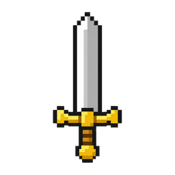

<div align="center">



# OPRN Studio

### 말하면 만들어지는 나만의 도트 JRPG.

[English](README.md) · [中文](README.zh-CN.md) · [日本語](README.ja.md) · **한국어**

[](https://github.com/MovieHolic-Plex/OpenRPGMaker/releases/latest/download/OPRN.Studio-windows.exe)
[](https://github.com/MovieHolic-Plex/OpenRPGMaker/releases/latest/download/OPRN.Studio-windows.zip)
[](https://github.com/MovieHolic-Plex/OpenRPGMaker/releases/latest/download/OPRN.Studio-linux.AppImage)

[](https://play.openrpgmaker.com/?lang=ko)
[](https://store.openrpgmaker.com/?lang=ko)
[](https://openrpgmaker.com/)
[](https://github.com/MovieHolic-Plex/OpenRPGMaker/releases)
[](LICENSE.md)
[](LICENSE-RUNTIME.md)

<a href="https://play.openrpgmaker.com/games/fallen-star?lang=ko"></a>

<sub><b>폴른 스타</b> — OPRN Studio 로 만든 데모 JRPG. <a href="https://play.openrpgmaker.com/games/fallen-star?lang=ko">브라우저에서 바로 플레이 →</a></sub>

<br/>

[데모](#데모-플레이) · [새로워진 점](#새로워진-점) · [특징](#특징) · [화면](#안을-들여다보면) · [세계](#바로-쓰는-세계) · [다운로드](#다운로드) · [빠른 시작](#빠른-시작) · [라이선스](#라이선스)

</div>

---

**OPRN Studio 는 AI 조수가 들어 있는 타일 JRPG 메이커입니다.**
맵을 그리고 이벤트를 놓고 바로 플레이해 보세요. 아니면 조수에게
*"교회와 주막이 있는 항구 마을 만들어 줘"* 라고 말하면 타일과 문, NPC 까지 깔아 줍니다.
맵은 16px 도트 타일로 짓고, 에디터는 네 가지 언어를 쓰며, 만든 게임은 만든 사람의 것입니다.

## 데모 플레이

아래 데모는 모두 OPRN Studio 로 만들었고, 설치 없이 브라우저에서 돌아갑니다.

<table>
  <tr>
    <td width="50%" valign="top">
      <a href="https://play.openrpgmaker.com/games/fallen-star?lang=ko"></a><br/>
      <b><a href="https://play.openrpgmaker.com/games/fallen-star?lang=ko">폴른 스타</a></b> · RPG<br/>
      <sub>동쪽 숲에 떨어진 별 속에서 기계 소녀가 깨어납니다. 심문관보다 먼저 그녀를 집으로 돌려보낼 신호를 찾아야 합니다. 1막과 2막 앞부분, 전투·컷신·세이브까지 들어 있습니다. 키보드와 터치 모두 됩니다.</sub>
    </td>
    <td width="50%" valign="top">
      <a href="https://play.openrpgmaker.com/games/first-love?lang=ko"></a><br/>
      <b><a href="https://play.openrpgmaker.com/games/first-love?lang=ko">첫사랑</a></b> · 연애<br/>
      <sub>첫 출근 날 사수로 배정된 사람은 10년 전 그 선배였습니다. 그런데 그는 「처음 뵙겠습니다」라고 합니다. 엔딩 셋, 약 20분. 휴대폰에서도 됩니다.</sub>
    </td>
  </tr>
  <tr>
    <td width="50%" valign="top">
      <a href="https://play.openrpgmaker.com/games/shitamachi-fourth-season?lang=ko"></a><br/>
      <b><a href="https://play.openrpgmaker.com/games/shitamachi-fourth-season?lang=ko">시타마치의 네 번째 계절</a></b> · 연애<br/>
      <sub>어릴 적 살던 도쿄 상점가로 돌아온 지 세 계절, 내일 밤은 등롱 축제입니다. 누구와 등롱 길을 걸을까요? 엔딩 넷, 약 15분.</sub>
    </td>
    <td width="50%" valign="top">
      <a href="https://play.openrpgmaker.com/games/maou-konbini?lang=ko"></a><br/>
      <b><a href="https://play.openrpgmaker.com/games/maou-konbini?lang=ko">전생한 마왕, 편의점 알바 시작하다</a></b> · 코미디<br/>
      <sub>암흑 마왕이 눈떠 보니 현대 일본의 원룸, 통장 잔고는 0엔. 편의점에서 사흘을 일하고, 용사와 다시 맞섭니다. 엔딩 셋.</sub>
    </td>
  </tr>
</table>

<div align="center"><a href="https://play.openrpgmaker.com/?lang=ko"><b>OPRN PLAY 에서 모든 게임 보기 →</b></a></div>

## 새로워진 점

2026년 10월 초 첫 공개 이후 들어간 것들입니다.

- 🎮 **휴대폰과 태블릿에서 플레이.** 내보낸 게임에 터치 조작이 들어갔습니다. 화면 스틱, 눌러서 걷기·말 걸기, 손가락 크기 메뉴를 쓰고, 세로·가로 화면에 맞춰 배치됩니다. OPRN PLAY 의 게임은 클라우드 세이브를 지원합니다.
- 🎵 **조수가 에셋을 골라 줍니다.** 장면과 분위기로 에셋 스토어를 찾아 음악을 설치하고 맵에 연결합니다. 내 게임에 달린 플레이어 리뷰를 읽고 답글 초안과 업데이트 소식도 써 줍니다.
- 🏰 **테마 던전.** 숲·얼음·늪·피라미드·용암·광산·지하묘지·마법사의 탑 등, 계단·레버·관문·보스 방까지 갖춘 던전을 짓습니다.
- 🧩 **조수가 맡는 일이 커졌습니다.** 스위치 퍼즐이 있는 파티 분리, 잠입 순찰, 모닥불 대화가 있는 동료 유대, 눈길·숲길 루트, 전투 도중 합류하는 손님.
- ⚔️ **더 깊어진 전투.** 최대 네 명이 함께 쓰는 연계기, 적의 기 모으기 끊기, 때려 봐야 알게 되는 약점, 물리·마법 피해 배율, 컷인 연출 편집기.
- 🛠️ **공방.** 맵 기물·걷는 캐릭터·지형을 한 줄 설명이나 사진으로 만들고, 마음에 드는 후보를 고릅니다.
- 🛒 **커지는 에셋 스토어.** 지금 무료 에셋 40개 — 음악 팩 18개, 타일셋 5개, 얼굴·초상 팩 15개가 있습니다.

## 특징

| | |
|---|---|
| 🤖 **AI 조수** | 말로 맵·마을·실내·던전·이벤트·대사를 만듭니다. Google(Gemini)이나 ChatGPT(Codex) 계정으로 로그인하면 되고 API 키는 필요 없습니다. |
| 🛒 **에셋 스토어** | [store.openrpgmaker.com](https://store.openrpgmaker.com/?lang=ko) 의 무료 타일셋·걷기 캐릭터·초상·음악. 에디터에서 찾고, 데스크톱 앱에서는 한 번 눌러 설치합니다. 직접 만든 것을 올릴 수도 있습니다. |
| 🎨 **도트 세계** | 로마풍 항구 도시, 조선 마을, 일본 도시, 마법 학교, 아늑한 실내, 테마 던전. |
| 🗺️ **제대로 된 에디터** | 층으로 나뉜 타일 맵, 높이와 절벽, 월드맵, 배우·스킬·아이템·적 자료집, 스위치·변수·분기를 쓰는 전통적인 이벤트 명령 목록. |
| 🎬 **연출** | 움직이는 타이틀 화면, 오프닝 컷신, 카메라 연출, 레터박스, 시차 배경, 16가지 표정의 대화 초상. |
| ⚔️ **측면 전투** | 도트 전투 캐릭터, 스킬, 상태, 연계기, 보상 — 모두 자료집대로 돌아갑니다. |
| 🌐 **어디서나 플레이** | 에디터 안에서 바로 테스트하고, 웹 게임으로 내보내고, [OPRN PLAY](https://play.openrpgmaker.com/?lang=ko) 에 공개합니다. 내보낸 플레이어는 MIT 라이선스입니다. |
| 🌏 **4개 언어** | 에디터는 영어·중국어·일본어·한국어를 지원합니다. |

## 안을 들여다보면


<p align="center"><sub>에디터에서 연 폴른 스타의 왕도</sub></p>

<table>
  <tr>
    <td width="50%"><br/><sub>말로 부탁하면 조수가 지금 보고 있는 맵에서 일합니다</sub></td>
    <td width="50%"><br/><sub>자료집 — 배우·직업·스킬·아이템·적</sub></td>
  </tr>
  <tr>
    <td width="50%"><a href="https://store.openrpgmaker.com/?lang=ko"></a><br/><sub>에셋 스토어 — 모든 에셋이 무료</sub></td>
    <td width="50%"><a href="https://play.openrpgmaker.com/games/fallen-star?lang=ko"></a><br/><sub>OPRN PLAY — OPRN Studio 로 만든 게임들</sub></td>
  </tr>
</table>

### 데모 속 장면

<table>
  <tr>
    <td width="33%"></td>
    <td width="33%"></td>
    <td width="33%"></td>
  </tr>
  <tr>
    <td width="33%"></td>
    <td width="33%"></td>
    <td width="33%"></td>
  </tr>
</table>

## 바로 쓰는 세계

기본 타일셋에는 조수가 읽는 참고문서가 함께 들어 있어서, 첫날부터 그 타일셋으로 지을 수 있습니다.

<table>
  <tr>
    <td width="50%"><br/><sub>강마을</sub></td>
    <td width="50%"><br/><sub>조선 궁궐</sub></td>
  </tr>
  <tr>
    <td width="50%"><br/><sub>일본 마을</sub></td>
    <td width="50%"><br/><sub>개울가의 조선 마을</sub></td>
  </tr>
  <tr>
    <td width="50%"><br/><sub>플레이 모드로 본 일본 집</sub></td>
    <td width="50%"><br/><sub>전차 선로가 있는 거리</sub></td>
  </tr>
</table>

## 다운로드

Windows·Linux 데스크톱 빌드는 [릴리스](https://github.com/MovieHolic-Plex/OpenRPGMaker/releases)마다 붙어 있습니다. 맨 위 버튼은 가장 새 빌드를 받습니다.

- **Windows** — EXE를 실행하거나, ZIP 압축을 풀고 `OPRN Studio.exe`를 실행하세요.
- **Linux** — AppImage에 `chmod +x` 로 실행 권한을 준 뒤 실행하세요.
- **macOS** — 아직 설치 파일이 없습니다. 아래 소스 명령을 쓰세요.

버튼을 눌렀는데 "Not Found" 가 나오면 새 릴리스를 올리는 중입니다. [릴리스 목록](https://github.com/MovieHolic-Plex/OpenRPGMaker/releases)에서 바로 앞 릴리스를 받으세요.

## 빠른 시작

macOS 이거나 소스로 실행할 때입니다. [Node.js 24 LTS](https://nodejs.org/) 가 필요합니다.

```bash
npm ci
npm run mac:launch   # macOS / Linux — 프로젝트 폴더를 물어본 뒤 http://127.0.0.1:9999 를 엽니다
```

처음 실행하면 **새** 폴더의 전체 경로를 입력하세요. 프로젝트는 그 폴더에 SQLite 와 에셋 파일로 저장됩니다.
오른쪽 위 AI 칩을 눌러 로그인하세요.

전체 281곡은 위 데스크톱 파일이 아니라 공개 [bgm-v1 릴리스](https://github.com/MovieHolic-Plex/OpenRPGMaker/releases/tag/bgm-v1)의 `rpg-zzu-bgm-v1.tar` 입니다. 소스에서 `npm run bgm:install` 을 실행하면 HTTPS로 받아 커밋된 SHA-256으로 검증합니다. GitHub CLI는 그 다운로드가 거절될 때만 씁니다.

## 개발자용

```bash
npm ci
npm run dev              # 개발 서버 (http://localhost:9999)
npm run build:packaged   # 호스팅 / 데스크톱 렌더러 빌드
npm run build:player     # 독립 웹 게임 플레이어
npm start -- --project-dir /path/to/project   # 기존 SQLite 프로젝트 열기
npm test                 # 단위 테스트 (GitHub CI 용; 로컬에서는 OPRN_LOCAL_TESTS=1 일 때만 실행)
```

- 구조·데이터·에디터 안내는 [`openwiki/`](openwiki/) 에 있습니다. [`openwiki/quickstart.md`](openwiki/quickstart.md) 와 [`openwiki/PROJECT_WIKI.md`](openwiki/PROJECT_WIKI.md) 부터 보세요.
- 코딩 에이전트는 [`AGENTS.md`](AGENTS.md) 를 먼저 읽으세요.
- 구성: Phaser + 순수 TypeScript DOM, SQLite 프로젝트 폴더, Electron 데스크톱 셸.
- 월드맵 장소 아이콘은 별도 공개 저장소 [oprn-worldmap-kit](https://github.com/MovieHolic-Plex/oprn-worldmap-kit) 에 있습니다.

## 라이선스

| 부분 | 라이선스 |
|---|---|
| 에디터와 도구 | [Sustainable Use License 1.0](LICENSE.md) + 게임·산출물에 대한 추가 허가 |
| 내보낸 게임 플레이어 (런타임) | [MIT](LICENSE-RUNTIME.md) |
| 기본 그림과 소리 | [OPRN Game Use License](ASSET-LICENSE.md) — 게임에 자유롭게 사용 |
| 제3자 구성 요소 | [THIRD_PARTY_NOTICES.md](THIRD_PARTY_NOTICES.md) |
| 이름과 로고 | [TRADEMARKS.md](TRADEMARKS.md) |

**만든 게임은 만든 사람의 것입니다** — 팔아도 되고 나눠도 되며 로열티는 없습니다.
기여는 [CLA](CLA.md) 에 따라 환영합니다.

OPRN Studio 는 RPG Maker(쯔꾸르), Gotcha Gotcha Games, KADOKAWA 와 관계가 없습니다.
